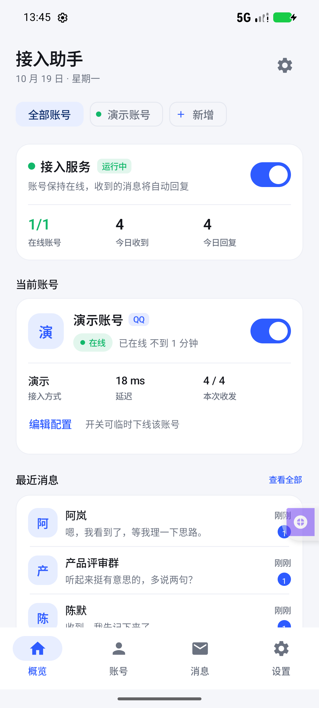
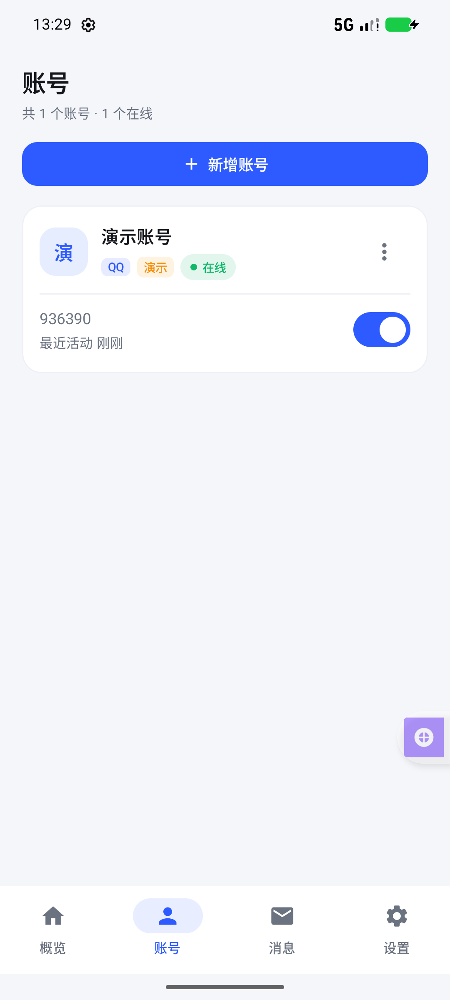
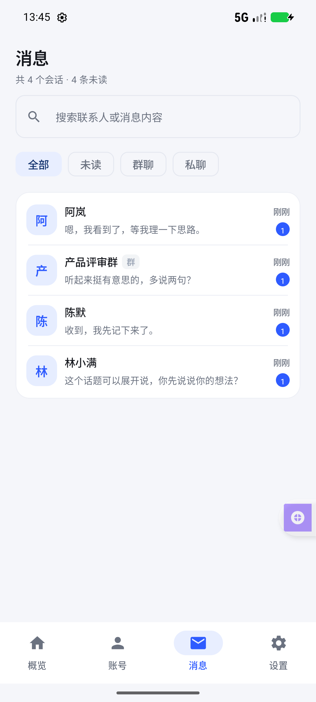
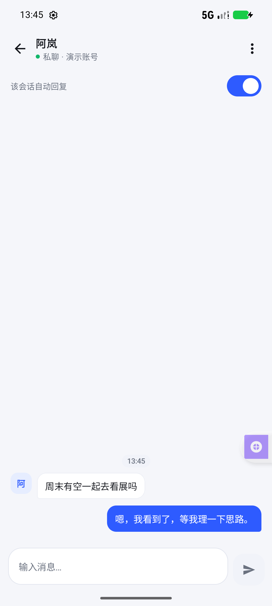

# AiLink（接入助手）


把闲置的 QQ / 微信 账号接入 AI 服务，实现自动回复的 Android 客户端。负责账号接入配置、消息收发、自动回复、在线状态、消息记录与账号切换。

> 本应用自身不破解、不代理任何官方协议。真实账号接入通过你自建的桥接端完成（OneBot v11 正向 WebSocket），AiLink 是桥接端的管理与 AI 回复客户端。

| 概览 | 账号 | 会话 | 聊天 |
| -- | -- | -- | -- |
|  |  |  |  |

更多界面见 [`docs/screenshots/`](docs/screenshots/)（AI 服务配置、手机内置运行时自检等）。

## 功能

- **账号接入**：通过任意 OneBot v11 桥接端（NapCat / LLOneBot / Lagrange 等）接入 QQ，或经 HTTP 回调接入微信桥；地址 + 令牌一键「测试连接」，支持扫码/粘贴配对码自动填表
- **AI 自动回复**：兼容 OpenAI Chat Completions 的任意服务（OpenAI、DeepSeek、通义、Moonshot、Ollama、LM Studio、One-API 等）；触发范围（仅私聊 / 私聊+群@ / 全部）、回复延迟、忽略关键词、会话级开关、人设提示词、最近 8 条多轮上下文
- **消息管理**：前台服务常驻收消息、消息落库、会话搜索与筛选、未读数、手动发消息、失败重试、AI 回复打标
- **运行可观测**：在线数、连接状态、心跳 RTT、回复成功率与平均首响等本地统计；日志导出（桥接端日志 + 应用侧会话日志）
- **应用内自更新**：自动检查 GitHub Releases 新版本，应用内下载（可配镜像前缀）并交给系统安装器安装
- **手机内置 QQ 运行时（进阶）**：可选地把 proot 容器 + Ubuntu rootfs + QQ Linux + NapCat 全部打进 APK，手机内单机运行桥接端，无需电脑（详见 [`HANDOVER.md`](HANDOVER.md)）
- **演示模式**：首次启动内置演示账号与本地模拟回复，不接任何真实平台即可跑通全链路

## 快速开始

### 1. 构建安装包

要求：JDK 17、Android SDK（compileSdk 34，Android Studio 打开会自动补齐）。

```bash
git clone <本仓库地址>
cd ailink/android
./gradlew assembleDebug
# 产物：app/build/outputs/apk/debug/app-debug.apk（debug 包名带 .debug 后缀，可与正式包并存）
adb install -r app/build/outputs/apk/debug/app-debug.apk
```

依赖仓库已配置国内镜像（腾讯云 Gradle 发行包 + 阿里云 Maven，见 `android/settings.gradle.kts`），海外网络可自行替换为官方源。

### 2. 演示模式先跑通（零配置）

1. 首次启动已内置「演示账号（本地演示）」与「内置模拟回复」；
2. 概览页打开「接入服务」开关；
3. 约 10 秒后开始出现模拟消息并自动回复；
4. 消息页可查看会话，聊天页可手动发消息。

### 3. 接入真实 QQ

1. 在桥接端（NapCat / LLOneBot / Lagrange 等）登录要接入的账号，开启「正向 WebSocket 服务端」，记下端口与 token。桥接端的安装与配置示例见 [`bridge/README.md`](bridge/README.md)；
2. App 内新增账号 → 平台选 QQ → 接入方式选「OneBot v11 桥接」→ 填 `ws://<桥接端IP>:<端口>` 与 token → **测试连接**；
3. 省事的做法：在桥接端电脑上执行 `node tools/pairing/make-pairing.mjs`（需 Node.js），把输出的 `ailink://` 配对码粘贴到 App「账号 → 配对码导入」，地址与令牌会自动填好并自动测试连接；
4. 保存后打开总开关，账号状态变「在线」即接入成功。手机与桥接端需网络互通；跨网络请用 `wss://` 或内网穿透。

### 4. 配置 AI 服务

- **快速配置（推荐）**：App → AI 服务 → 新增，在「快速配置」里点选厂商（DeepSeek、通义千问、Kimi、智谱 GLM、豆包方舟、硅基流动、腾讯混元、OpenAI、Ollama 本地），接口地址与常用模型自动填好，只需再粘贴该厂商控制台签发的 API Key；
- **手动配置**：也可直接填接口地址（如 `https://api.deepseek.com/v1`）、密钥、模型名（如 `deepseek-chat`）；
- 兼容所有 OpenAI Chat Completions 风格接口；接口地址留空 = 使用内置模拟回复；
- **图片识别（可选）**：配置页「图片识别」开关打开后，应用会先按模型名判断、再用一张测试图实测当前接口能否识图；确认支持时，聊天里的图片与表情包会先下载并转成 JPEG 再交给模型理解，不支持或关闭时仍按 `[图片]` 纯文本处理；
- 账号编辑页可设置人设与回复延迟，AI 服务页可调整温度与最大 Token。

## 项目结构

```
ailink/
├── android/                     Gradle 多模块工程（Kotlin + Compose，6 模块单向依赖）
│   ├── app/                     应用壳：Application / Manifest / assets / 构建期脚本同步
│   ├── ui/                      Compose 界面：主题 / 通用组件 / 8 个页面 / 导航
│   ├── assembly/                装配层：AppContainer 手写依赖注入
│   ├── engine/                  业务引擎：BotManager / 前台服务 / 容器运行时
│   ├── data/                    数据层：Room / 仓库 / OneBot 网关 / AI 客户端
│   └── core/                    内核：模型 / 枚举 / 偏好 / 日志 / 配对解析
├── bridge/                      桥接端配置与脚本（NapCat 示例）
├── tools/                       配对码生成、容器装配脚本、Termux 部署
├── docs/                        架构说明、运维文档、界面截图
└── HANDOVER.md                  手机内置 QQ 运行时技术交接（架构 / 踩坑 19 条 / 排障手册）
```

模块依赖方向严格单向：`:app → :ui → :assembly → {:data, :engine} → :core`。每个模块的职责边界见 [`docs/architecture/module-map.md`](docs/architecture/module-map.md)。

## 数据与隐私

- 账号配置、消息记录全部保存在本机 Room 数据库，不经过任何中转服务器；
- AI 调用只发送当前会话的最近上下文，直连你配置的接口地址；
- 应用已关闭 `allowBackup`；设置 → 数据 → 清空全部聊天记录（不可恢复）。

## 已知边界

- QQ 消息仅支持文本与常见富媒体的占位显示（`[图片]`、`[语音]`），不做媒体下载；
- 「手机内置 QQ 运行时」首次登录必须借助第二块屏幕扫码（腾讯安全策略，无法绕过）；APK 约 72 MB，容器安装需再下载约 350 MB；
- 息屏保持在线需电池白名单，代价约 3–8%/小时；各品牌具体配置步骤见 [`docs/ops/手机后台保活设置指南.md`](docs/ops/手机后台保活设置指南.md)；
- 平台协议由第三方桥接端实现，桥接端版本升级可能需要同步调整。

## 参与贡献

欢迎 Issue 与 PR。开始前请阅读 [CONTRIBUTING.md](CONTRIBUTING.md)（开发环境、提交规范、测试方法）。修改「手机内置运行时」相关代码前，务必先读 [HANDOVER.md](HANDOVER.md) 的踩坑档案。

安全漏洞请勿使用公开 issue，参见 [SECURITY.md](SECURITY.md)。

## 许可证与合规

- 本项目自有代码以 [Apache-2.0](LICENSE) 许可发布（`Copyright (c) 2026 wenshi`）；
- **APK 内捆绑的第三方组件受其自身许可约束**，尤其是 NapCat（NapCat.Shell.zip）：NapCat 采用其作者的「Limited Redistribution License」，**禁止商业用途**。因此包含该组件的 APK 整体不可用于商业分发；商用需求请自行下载 NapCat 或向其作者取得授权。各组件的来源与许可全文见 [THIRD-PARTY-NOTICES.md](THIRD-PARTY-NOTICES.md)；
- 平台风险提示：NapCat 等属于非官方协议实现，可能触发平台风控，导致限制登录甚至封号。请只接入你本人拥有合法使用权的账号，遵守腾讯相关用户协议，先用小号验证；不要用于营销群发、自动加好友、批量养号等用途。生产环境建议改用官方通道（企业微信应用、QQ 官方机器人开放平台）——本项目的 `MessageGateway` 抽象已为此预留扩展点。
